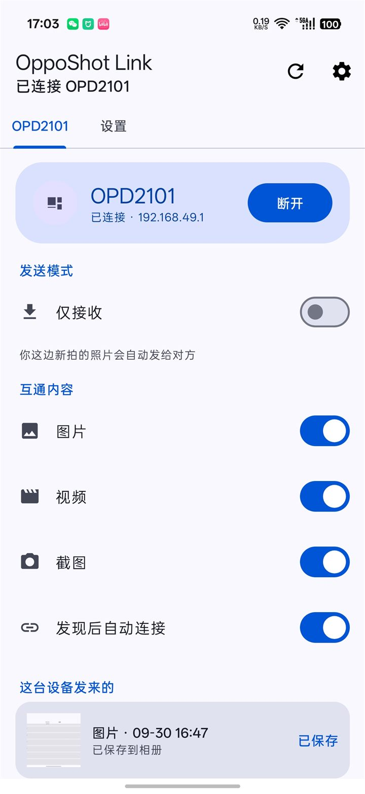

# OppoShot Link

在 **OPPO / 一加设备**之间自动传图片、视频、截图的 Android 应用。

拍完照，平板那边自动收到，点一下就存进相册。



---

## 它解决什么问题

平板和手机之间传图，最常见的做法是：开微信 → 选文件 → 发送 → 另一台下载 → 找文件 → 导入相册。

六步。还要担心流量、压缩画质、传输中断。

这个 App 做的事：**拍照 → 另一台自动收到 → 点通知 → 存进相册。** 三步，全程不经过互联网。

## 特点

- **不经过路由器。** 走 OPPO / 一加系统自带的「跨设备互联」拉起的虚拟网卡，
  实测 200+ Mbps。家里的路由器再快也比不过它，而且不占用 Wi-Fi 带宽。
- **不经过互联网。** 没有服务器、没有账号、没有云端。数据只在两台设备之间直接流动。
- **不压缩画质。** 传输的是原图，不是压缩包。
- **后台可用。** 官方前台服务（`FOREGROUND_SERVICE_TYPE_CONNECTED_DEVICE`）+ 保活自愈，
  息屏也能收到。

## 怎么用

### 1. 前提：两台设备都要打开「跨设备互联」

这是系统自带的功能，在控制中心下拉里找「跨设备互联 / 跨屏互联」。

> 没有它，App 无法工作 —— 传输链路完全依赖系统提供的这条虚拟网卡。

### 2. 安装

从 [Releases](https://github.com/你的用户名/OppoShotLink/releases) 下载 APK，装到两台设备上。

### 3. 授权

首次打开会请求三个权限：

| 权限 | 用途 |
|---|---|
| 照片和视频 | 读取新拍的照片、写入收到的照片 |
| 通知 | 收到图片时提醒你 |
| 附近设备 | 建立 OPPO 直连链路 |

> **重要**：照片权限请选「**允许访问所有照片**」，不要选「选择部分照片」。
> 选了部分授权的话，App 只能看到你勾选的那几张 —— 这在 Android 14+ 上
> **不会显示为未授权**（`checkSelfPermission` 依然返回 granted），
> 但表现是「明明有图却传不过来」。

### 4. 用起来

- 拍照 / 截图 → 另一台自动弹出通知
- 点通知 → 传输原图 → 自动存进 `Pictures/OppoShotReceived/`
- 通知 2 分钟自动消失；错过了可以在 App 的「这台设备发来的」里找到

## 界面说明

App 采用「一台设备一页」的设计：顶部是设备标签，**左右滑动**切换。

每一页里是这台设备的：

- 连接状态（连接 / 断开）
- **发送模式** —— 「仅接收」打开后照常收，但不把自己的相册发过去
- **互通内容** —— 图片 / 视频 / 截图 三个开关
- **发现后自动连接**
- 「这台设备发来的」—— 历史记录，可补保存

## 工作原理

```
┌──────────┐   OPPO 跨设备互联    ┌──────────┐
│  平板    │◄──────────────────►│   手机    │
│          │   p2p0 虚拟网卡     │          │
│ 192.168.49.1                 192.168.49.100
└──────────┘                     └──────────┘
     │                                │
     │  UDP 45556  广播发现           │
     │◄──────────────────────────────►│
     │                                │
     │  TCP 45555   文件传输          │
     │◄──────────────────────────────►│
```

**发现**：双方在 `192.168.49.255` 上每 3 秒广播一次 `I_AM`（我是谁 + 我的端口）。

**传输**：自定义二进制帧，格式为 `[4B "OSS1"][1B type][4B length][payload]`，
256 KB 一片，整文件 SHA-256 校验后才写进相册。

**为什么只在 p2p0 上发现？** 实测在校园网、企业网这类多 AP 环境里，
同一 SSID 的两台设备经常互相看不见（AP 隔离 / NAC 终端隔离）——
系统 `ping` 测出来是「都能 ping 通网关和电脑，但两台之间 100% 丢包」。
走局域网发现只会露出一堆连不上的设备，所以干脆不找。

## 安全边界

- **只接受来自 p2p0 网段的连接。** 端口虽然监听在 `0.0.0.0`，
  但其他网段（同一个 Wi-Fi 里的陌生设备）连上来会被立即拒绝。
- **只回应来自 p2p0 网段的发现包。** 公共 Wi-Fi 里看不到本机的设备名和 ID。
- **不做局域网扫描。** 不探测任何不属于 OPPO 直连网段的地址。

需要说明的是：**没有身份认证和加密。** p2p0 网段本身由系统建立和管理，
能进这个网段的就是互联的两台设备，所以这里没有再加一层。
如果你要把这个 App 用在更不可信的网络环境下，请注意这一点。

## 兼容性

| | |
|---|---|
| 支持 | OPPO / 一加 / realme 手机与平板，且系统提供「跨设备互联」 |
| 不支持 | 手机 ↔ 手机（OPPO 互联只支持手机 ↔ 平板） |
| 不支持 | iOS / 其他品牌 |
| minSdk | 26（Android 8.0） |

## 构建

需要 JDK 17 或 21、Android SDK。

```powershell
$env:ANDROID_HOME="$env:LOCALAPPDATA\Android\Sdk"
.\gradlew.bat :app:assembleDebug
```

产物在 `app/build/outputs/apk/debug/app-debug.apk`。

技术栈：Kotlin + Material Components，**除 UI 库外无第三方依赖**。

## 已知限制

- 只能传**相册里的**图片/视频。平板里的文档、PDF 传不了。
- 一对一。不支持三台设备同时互联。
- 息屏后如果 OPPO 互联被系统关闭，传输会中断。
  平板作为接收端建议把「屏幕超时」设成永不，否则收不到通知。

## 许可

MIT
